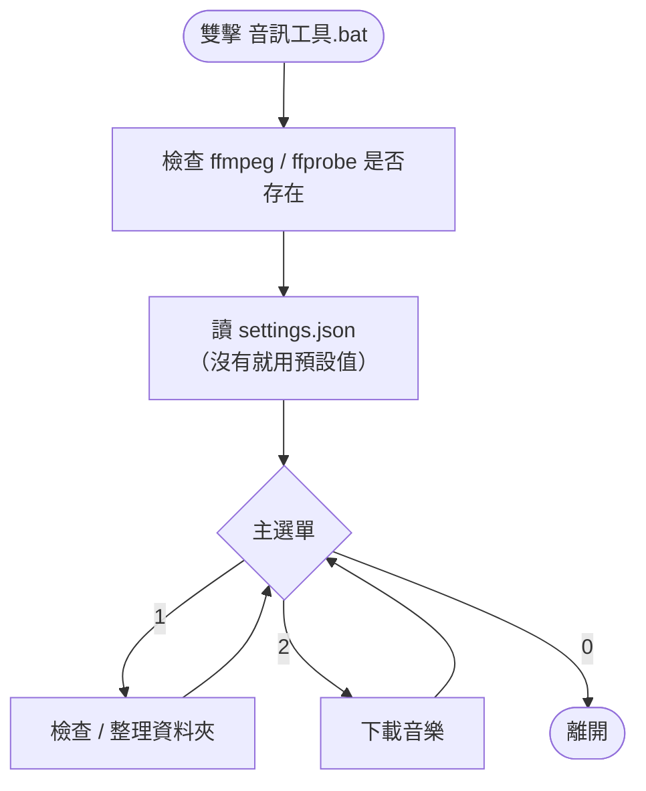
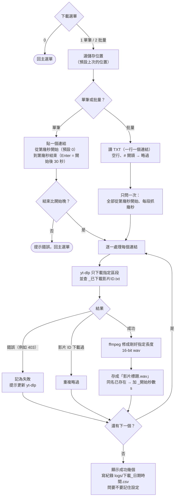
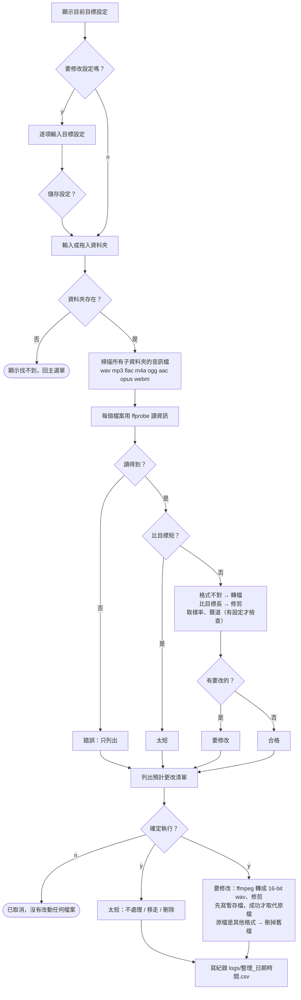

# 音訊整理工具

蒐集測試音訊用的小工具：從 YouTube 下載指定區段存成 wav，以及檢查 / 整理資料夾裡音訊的格式與長度。

改編自德育同學的 `yt2wav - time.bat`（一次貼一個連結、輸入開始與結束時間）。這版加上選單、批量下載、資料夾檢查與設定記憶。

## 功能

| 功能 | 說明 |
|---|---|
| 單筆下載 | 貼一個連結，自己指定「第幾秒到第幾秒」 |
| 批量下載 | 讀 TXT（一行一個連結），開始前只問一次「從第幾秒開始、抓幾秒」，全部統一 |
| 擋重複下載 | 同一部影片（YouTube 影片 ID）在同一個儲存資料夾只下載一次 |
| 精準長度 | 下載後用 ffmpeg 修成剛好指定的長度（多的截掉、不足補靜音），16-bit wav |
| 檢查 / 整理資料夾 | 掃描所有子資料夾，列出格式、長度不符的檔案，確認後才修改 |
| 設定記憶 | 儲存位置、TXT 路徑、批量時間、整理規則都可以記住，下次直接沿用 |

## 安裝需求

- Python 3（有 `python` 指令）
- [yt-dlp](https://github.com/yt-dlp/yt-dlp)：`python -m pip install -U yt-dlp`
- [ffmpeg](https://ffmpeg.org/)（含 `ffprobe`），要加進系統 PATH

確認方式：在命令提示字元輸入 `python -m yt_dlp --version` 和 `ffmpeg -version`，兩個都有版本號就可以了。

## 使用方法

雙擊 **`音訊工具.bat`**，會出現選單：

```
═══════ 音訊整理工具 ═══════
1. 檢查 / 整理資料夾（時長、格式）
2. 下載音樂
0. 離開
```

操作提示：

- 中括號 `[...]` 裡是預設值，直接按 Enter 就是用它
- 資料夾、TXT 可以從檔案總管直接拖進視窗，不用手打路徑
- 按 `Ctrl + C` 中斷目前的工作，回到主選單

### 下載

選 `2`，再選單筆或批量，接著選儲存位置。

**單筆**

```
貼上連結：https://www.youtube.com/watch?v=xxxx
從第幾秒開始（例：35、1:15） [0]：1:00
到第幾秒結束（直接 Enter = 開始後 30 秒） [1:30.00]：1:10
```

**批量**：先用記事本準備一個 TXT，一行一個連結：

```
# 這行是註解，會略過
https://www.youtube.com/watch?v=aaaa
https://www.youtube.com/watch?v=bbbb

https://www.youtube.com/watch?v=cccc
```

空行和 `#` 開頭的行會略過；連結後面多寫的字不會使用。執行時只問一次：

```
全部從第幾秒開始（例：30、1:15） [0:30]：0:40
每段抓幾秒 [30.0]：30
```

時間可以寫 `35`（秒）、`1:15`（分:秒）、`1:02:03`（時:分:秒）。

建議音樂和語音分成兩個 TXT、分兩次下載，存到不同資料夾。

### 檢查 / 整理資料夾

選 `1`，可以先修改目標設定，再拖入要檢查的資料夾。工具會先列出「預計更改清單」，**按 `y` 之前不會動到任何檔案**。

```
── 預計更改清單 ──  合格 362、要修改 21、太短 1、讀不到 0
  [修改] 皮卡丘\200秘密\bN3StB5t.wav  →  修剪 30.70 → 30 秒（保留中間）
  [修改] 皮卡丘\200音樂\xxx.mp3  →  轉檔 .mp3 → .wav
  [太短] 詹為真\200音樂\yyy.wav  →  太短 29.00 秒 → 不處理，只列出
```

可設定的目標：

| 設定 | 選項 | 預設 |
|---|---|---|
| 目標格式 | 副檔名，例如 `wav` | `wav` |
| 目標時長 | 秒數，±0.05 秒內算合格 | 30 |
| 過長怎麼修剪 | 保留中間 / 保留開頭 | 保留中間 |
| 太短怎麼辦 | 不處理只列出 / 移到「資料夾_太短」/ 刪除 | 移到「資料夾_太短」 |
| 修改後 | 直接覆蓋原檔 / 另存到「資料夾_整理後」 | 直接覆蓋原檔 |
| 取樣率、聲道 | 數值，0 = 不改 | 不改 |

「保留中間」的起點 =（原長 − 目標長度）÷ 2，例如 40 秒的檔案切第 5～35 秒。

## 流程圖

### 主選單



### 下載



### 檢查 / 整理資料夾



## 檔案說明

| 檔案 | 說明 |
|---|---|
| `音訊工具.bat` | 雙擊開啟選單（設定 UTF-8，中文不亂碼） |
| `audio_tool.py` | 主程式 |
| `README.html` | 這份說明的網頁版，雙擊用瀏覽器開（流程圖需要網路） |
| `settings.json` | 記住的設定，第一次選擇儲存時產生（不進 git） |
| `logs/` | 每次下載、整理的紀錄 csv（不進 git） |
| `<儲存資料夾>/_已下載影片ID.txt` | 擋重複下載用的影片 ID 紀錄（yt-dlp `--download-archive`） |

## 限制與注意事項

- **擋重複只看影片 ID**：同一首歌如果是另一部影片（別人上傳的），工具擋不住；音樂、語音存在不同資料夾時，兩邊各有一份紀錄。
- **批量時間是統一的**：沒辦法替 TXT 裡個別的連結指定不同時間；要不同時間請用單筆下載。
- **檔名用影片標題**，Windows 不允許的字元（`\ / : * ? " < > |`）會換成 `_`。
- **「直接覆蓋原檔」無法復原**，轉檔時舊格式的原檔會被刪掉；不確定時先改成「另存到新資料夾」。
- **下載出現 403 / ffmpeg exited**：多半是 YouTube 改了機制，執行 `python -m pip install -U yt-dlp` 更新後再試。
